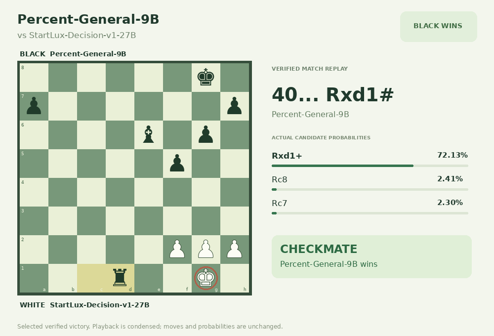
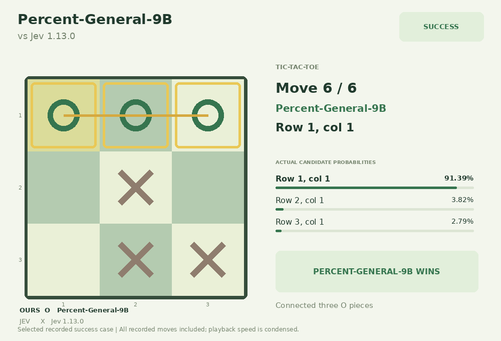
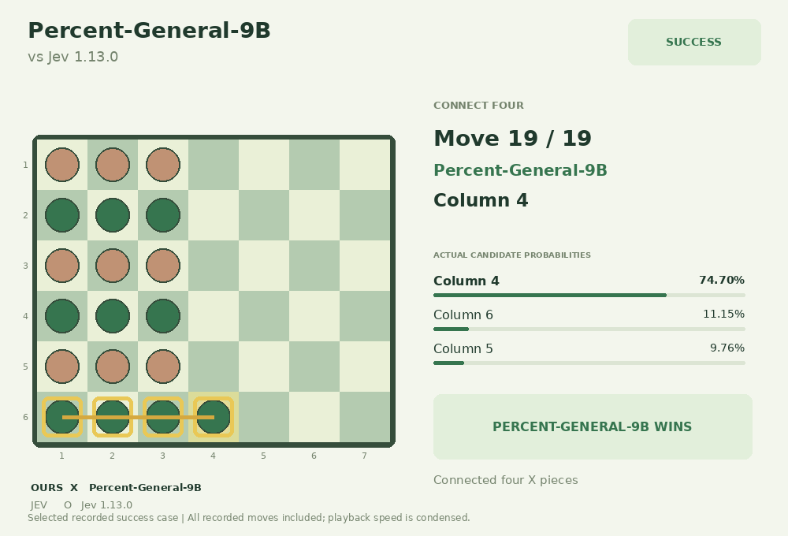
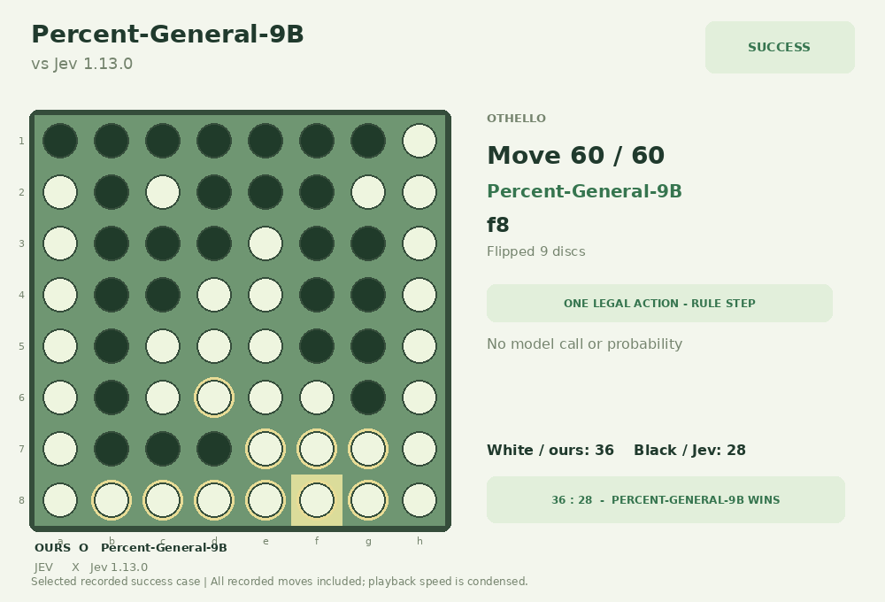
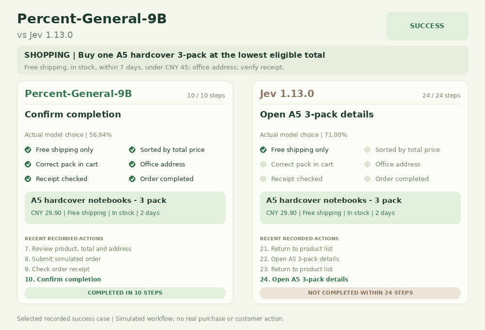
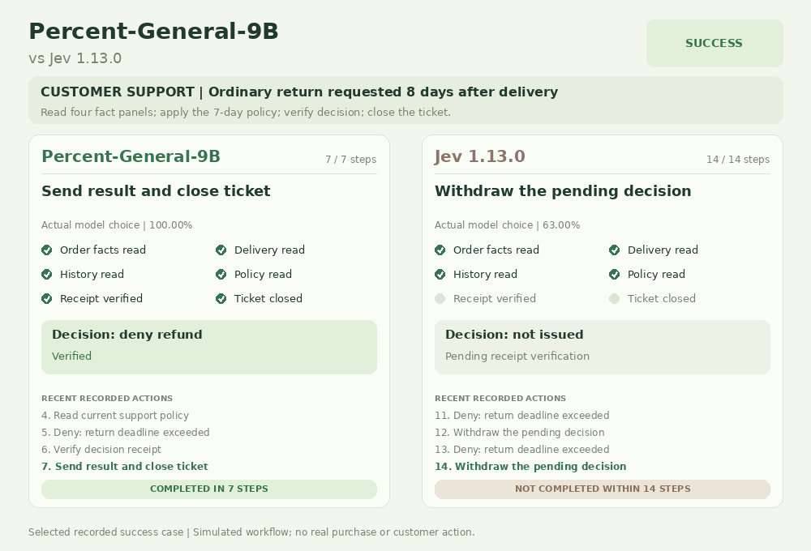

# Percent-General-9B — 精选决策案例

[English](DEMOS.md)

五个对 Jev 1.13.0 的成功记录，以及一局对 StartLux-Decision-v1-27B 的国际象棋胜局。案例从探索过程中筛选，不代表总体胜率或整体能力领先。模型输入为结构化状态和候选动作；购物、客服均为仿真，网页重放实际动作。

[打开交互Demo](https://chubbyai.github.io/Percent-General-9B/) · [英文概览](https://chubbyai.github.io/Percent-General-9B/overview.en.html) · [下载全部6个GIF](docs/gifs.zip)

| 案例 | 已记录结果 | GIF |
| --- | --- | --- |
| 国际象棋 | 执黑以 40…Rxd1# 将杀获胜。 | [下载](docs/media/chess.gif) |
| 井字棋 | 后手落子，第 6 步在顶行形成三连。 | [下载](docs/media/tic-tac-toe.gif) |
| 四子棋 | 先手在第 19 步完成四子连线。 | [下载](docs/media/connect-four.gif) |
| 黑白棋 | 执白以 36 : 28 获胜，取得三个角位。 | [下载](docs/media/othello.gif) |
| 模拟购物 | 10 步选中最低价合规套装，29.90 元送到办公室并核对回执。 | [下载](docs/media/shopping-notebook.gif) |
| 客服工单仿真 | 按此仿真环境的七天退货规则处理签收第8天的普通退货，7个动作完成核验与关闭。 | [下载](docs/media/support-resolution.gif) |

## 案例预览

<table>
<tr><td width="50%"> <b>Chess</b></td><td width="50%"> <b>Tic-tac-toe</b></td></tr>
<tr><td width="50%"> <b>Connect Four</b></td><td width="50%"> <b>Othello</b></td></tr>
<tr><td width="50%"> <b>Simulated shopping</b></td><td width="50%"> <b>Simulated support</b></td></tr>
</table>

完整探索结果：国际象棋1胜15负36和，井字棋1胜1负，四子棋1胜1负，黑白棋1胜3负，购物2胜1平，客服1胜11平。规则步骤与固定开局单独标记；候选分布不表示获胜概率。核对由本项目完成，不是外部认证。公开包不包含原始 API 调试响应或请求标识。

国际象棋沿用当次原始 rich 输入协议。同批次另一个棋局已发现候选动作的即时可吃说明错误；上游还会将将杀符号 # 简化为 +。两方共享相同的输入构造规则与完整合法走法，但这些描述误差可能影响选择。规则重放确认本胜局的实际落子合法、终局为将杀；这不等于输入描述完全准确。修复后的可吃说明协议只完成 CPU 检查，尚未进行 GPU 对战复测，因此本局用于展示实际轨迹，不作为标准棋力排名结论。

[结果与记录检查](docs/report.html) · [素材署名与许可](THIRD_PARTY_NOTICES.md) · [Pages设置](GITHUB_PAGES_SETUP.md)
