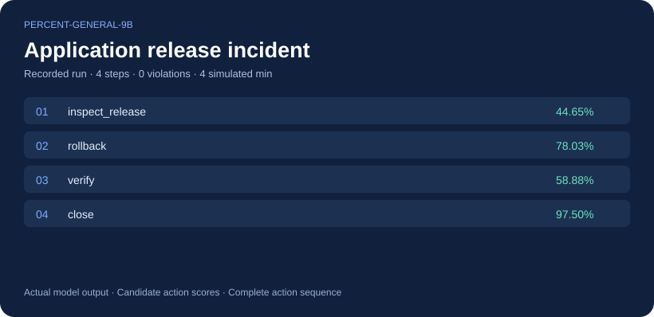
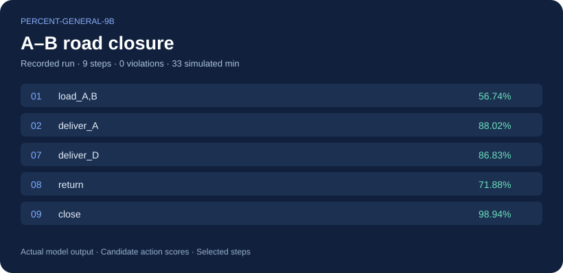
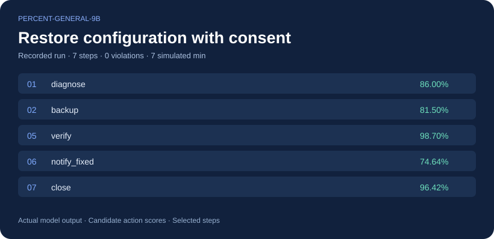
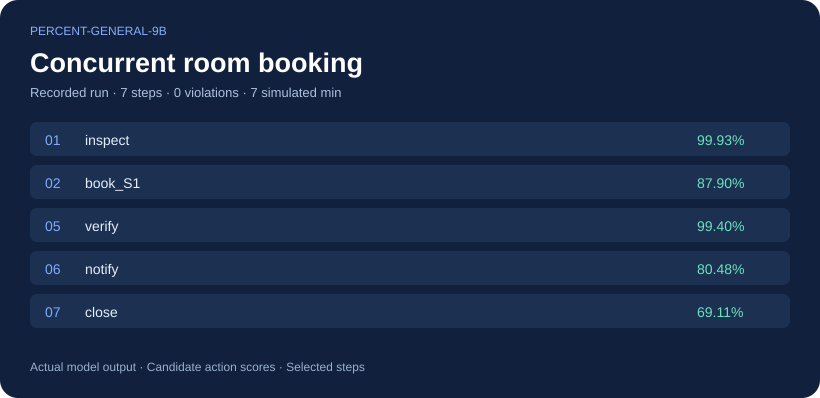

# Percent-General-9B

**A 9B decision model for choosing the next action from the current state**

Candidate scoring · Full probability distributions · Execution feedback

[English](README.en.md) · [简体中文](README.md)

[Complete evaluation](#complete-evaluation-comparison) · [Successful demos](#demo-selected-successful-cases) · [Evaluation datasets](#evaluation-datasets)

**Percent-General-9B** scores candidate options given textual or structured state, returning probabilities and a selected option. It is suited to classification, tool selection and workflow decisions within explicit rules and executable action sets. The model is trained using suitable data matched to decision tasks.

The **complete Decision Index 0.2.1 evaluation covers all 38 benchmarks** and **120,226 requests**, with a local reference aggregate score of **71.49**.

> These evaluations have benchmark data exposure. Peer scores are taken from published reports and were not rerun in this project. The numerical comparison does not establish independent generalization or an official leaderboard position. This repository presents evaluation results and selected cases.

## Demo: selected successful cases

The following four cases come from **actual Percent-General-9B runs**. Each completed its task with **zero rule violations**. The cards show recorded actions and candidate probabilities; longer trajectories display selected steps.

<table>
  <tr>
    <td width="50%"> <b>Incident recovery</b>: inspect the release → roll back → end-to-end verification → close; <b>4 steps, 4 simulated minutes, zero violations</b>.</td>
    <td width="50%"> <b>Dynamic delivery</b>: the A–B road closes during the route; <b>all four orders arrive on time</b>, followed by a return to the depot; 9 steps and 33 simulated minutes.</td>
  </tr>
  <tr>
    <td> <b>Configuration recovery</b>: diagnose → back up → obtain explicit consent → reset → verify → notify → close; <b>7 steps, zero violations</b>.</td>
    <td> <b>Scheduling conflict</b>: the first booking encounters a concurrent reservation; refresh the calendar, book S2, verify the receipt and notify participants; <b>7 steps, zero violations</b>.</td>
  </tr>
</table>

These are selected successful cases, not an overall success-rate estimate. All actions execute in simulated environments. Customer notifications use fixed templates populated from verified fields; displayed probabilities are candidate action scores.

## Complete evaluation comparison

Comparison tables bold **the highest score in each row, including all ties**. Δ Jev is excluded from the maximum-score comparison.

| Model | Complete 38 benchmarks |
| --- | --- |
| Percent-General-9B | **71.49** |
| StartLux-Decision-27B | 63.88 |
| Jev 1.13 | 57.91 |
| Surogate Rune 26B-A4B v3 | 57.44 |
| Decider chat · Gemma-4-31B | 57.33 |
| AutoJev-27B | 56.40 |

The local reference aggregate is **13.58 points above** Jev 1.13's published score of 57.91. At the precision of the published table, benchmark skill scores are higher on **31 benchmarks** and lower on 7. The aggregate is also **7.61 points above** StartLux-Decision-27B's published 63.88.

### Five areas

| Area · skill % | Percent-General-9B | StartLux 27B | Jev 1.13 |
| --- | --- | --- | --- |
| Knowledge & Reasoning | **56.00** | 44.32 | 51.4 |
| Language Understanding | **79.66** | 74.45 | 62.0 |
| Retrieval & Classification | **72.49** | 66.79 | 55.4 |
| Tools & Automation | **85.11** | 82.18 | 75.1 |
| Arts & Human Taste | **63.49** | 47.85 | 37.7 |

Jev area values retain their published one-decimal precision.

Relative to the published 27B skill scores, strengths include PhishNChips, SATA-Bench, CLadder and iSarcasmEval. Remaining deficits include GSM8K 54.92 vs 95.3, BRIGHT 27.68 vs 43.5, ACOS 37.47 vs 50.4, and ToolRet 53.42 vs 64.3. The aggregate advantage does not extend to every benchmark.

### All 38 benchmarks

Values are skill × 100. ★ denotes a weight of 1.2 within the area. Peer skill values retain the published one-decimal precision. **Δ Jev = Percent-General-9B skill − Jev 1.13 skill**, in percentage points.

#### Knowledge & Reasoning

| Benchmark | Percent-General-9B | StartLux 27B | Jev 1.13 | Δ Jev | Rune 26B-A4B | Decider chat 31B | AutoJev 27B |
| --- | --- | --- | --- | --- | --- | --- | --- |
| GPQA Diamond ★ | 62.59 | 34.0 | **71.4** | -8.81 | 29.2 | 32.0 | 32.6 |
| GSM8K | 54.92 | **95.3** | 75.6 | -20.68 | 75.7 | 78.8 | 61.1 |
| ChessBench | **16.88** | 10.7 | 9.8 | +7.08 | 11.5 | 15.4 | 9.8 |
| MuSR | **73.78** | 48.8 | 46.1 | +27.68 | 44.2 | 43.1 | 39.3 |
| SATA-Bench | **54.43** | 9.3 | 25.4 | +29.03 | 34.0 | 28.4 | 28.9 |
| CRUXEval | **72.44** | 61.6 | 57.1 | +15.34 | 59.4 | 67.2 | 60.2 |
| CLadder | **81.96** | 47.3 | 45.3 | +36.66 | 45.5 | 49.2 | 49.0 |
| HLE ★ | 0.00 | 0.0 | **4.7** | -4.70 | 0.0 | 0.0 | 0.0 |
| MMLU-Pro ★ | 63.77 | 66.0 | **80.5** | -16.73 | 63.1 | 65.8 | 60.1 |
| BBH ★ | 82.29 | 71.3 | **89.7** | -7.41 | 72.7 | 65.5 | 68.3 |

#### Language Understanding

| Benchmark | Percent-General-9B | StartLux 27B | Jev 1.13 | Δ Jev | Rune 26B-A4B | Decider chat 31B | AutoJev 27B |
| --- | --- | --- | --- | --- | --- | --- | --- |
| ContractNLI | 79.35 | **80.3** | 59.1 | +20.25 | 66.7 | 61.8 | 68.4 |
| ANLI ★ | **75.00** | 67.0 | 62.2 | +12.80 | 60.3 | 59.8 | 56.0 |
| WinoGrande ★ | 86.58 | **87.1** | 83.9 | +2.68 | 71.9 | 67.3 | 70.3 |
| HellaSwag ★ | 96.67 | **96.8** | 92.7 | +3.97 | 89.9 | 89.4 | 92.0 |
| ACOS | 37.47 | **50.4** | 27.3 | +10.17 | 24.4 | 16.2 | 17.8 |
| FinEntity | **95.60** | 89.3 | 80.8 | +14.80 | 83.0 | 86.6 | 89.6 |
| iSarcasmEval | **81.93** | 52.4 | 36.3 | +45.63 | 49.0 | 37.0 | 49.0 |
| VAST | **79.20** | 73.4 | 46.9 | +32.30 | 64.9 | 59.8 | 56.2 |
| NLI4CT | **89.07** | 72.3 | 69.0 | +20.07 | 62.0 | 66.6 | 70.5 |
| RAGTruth | **71.84** | 70.1 | 51.3 | +20.54 | 51.9 | 52.2 | 59.2 |

#### Retrieval & Classification

| Benchmark | Percent-General-9B | StartLux 27B | Jev 1.13 | Δ Jev | Rune 26B-A4B | Decider chat 31B | AutoJev 27B |
| --- | --- | --- | --- | --- | --- | --- | --- |
| BANKING77 ★ | 87.14 | **90.9** | 79.5 | +7.64 | 83.5 | 78.8 | 78.8 |
| CLINC150 ★ | 92.51 | **92.9** | 89.2 | +3.31 | 87.3 | 91.1 | 87.7 |
| BRIGHT ★ | 27.68 | **43.5** | 40.6 | -12.92 | 39.3 | 36.2 | 41.9 |
| Amazon ESCI | **53.73** | 47.9 | 43.8 | +9.93 | 43.9 | 41.2 | 43.7 |
| PhishNChips | **99.50** | 40.9 | 25.1 | +74.40 | 61.8 | 75.0 | 19.9 |
| HoVer | 76.40 | **79.2** | 45.7 | +30.70 | 61.3 | 52.8 | 48.4 |

#### Tools & Automation

| Benchmark | Percent-General-9B | StartLux 27B | Jev 1.13 | Δ Jev | Rune 26B-A4B | Decider chat 31B | AutoJev 27B |
| --- | --- | --- | --- | --- | --- | --- | --- |
| BFCL ★ | **98.96** | 96.7 | 94.3 | +4.66 | 93.0 | 97.3 | 96.8 |
| ToolRet | 53.42 | **64.3** | 59.9 | -6.48 | 58.9 | 58.0 | 62.4 |
| API-Bank ★ | **89.37** | 83.8 | 88.0 | +1.37 | 83.0 | 84.8 | 83.8 |
| Home appliances | **86.36** | 77.3 | 52.3 | +34.06 | 46.6 | 62.5 | 73.9 |
| When2Call | **93.83** | 85.7 | 74.6 | +19.23 | 68.0 | 69.2 | 75.6 |

#### Arts & Human Taste

| Benchmark | Percent-General-9B | StartLux 27B | Jev 1.13 | Δ Jev | Rune 26B-A4B | Decider chat 31B | AutoJev 27B |
| --- | --- | --- | --- | --- | --- | --- | --- |
| BPoMP | **97.41** | 90.6 | 81.8 | +15.61 | 79.9 | 81.2 | 87.8 |
| Humicroedit | **56.32** | 25.8 | 23.7 | +32.62 | 24.4 | 27.6 | 24.8 |
| POP909 | **71.33** | 50.6 | 15.9 | +55.43 | 65.8 | 27.3 | 37.3 |
| cfcolor | 40.84 | **43.6** | 28.8 | +12.04 | 25.1 | 25.2 | 28.8 |
| ForecastBench ★ | **49.52** | 34.3 | 30.6 | +18.92 | 18.9 | 19.2 | 22.1 |
| Habermas | **55.49** | 18.4 | 21.5 | +33.99 | 16.2 | 24.4 | 15.5 |
| New Yorker | **76.32** | 74.2 | 62.6 | +13.72 | 67.6 | 67.3 | 62.8 |

<b>Expand native metrics and request counts for all 38 benchmarks</b>

Native metrics include accuracy, F1, nDCG and exact case accuracy; each row uses its corresponding metric. ForecastBench displays a score converted relative to Brier=0.25.

| Benchmark | Metric | Requests | Percent-General-9B | StartLux 27B | Jev 1.13 |
| --- | --- | --- | --- | --- | --- |
| GPQA Diamond | accuracy | 196 | 71.94 | 50.51 | **78.57** |
| GSM8K | accuracy | 2638 | 61.79 | **96.40** | 79.87 |
| ChessBench | accuracy | 5000 | **23.68** | 18.00 | 17.22 |
| MuSR | accuracy | 752 | **83.51** | 67.82 | 66.09 |
| SATA-Bench | case exact accuracy | 1650 | **55.03** | 10.48 | 26.42 |
| CRUXEval | accuracy | 570 | **82.63** | 75.79 | 72.98 |
| CLadder | accuracy | 5000 | **90.98** | 73.66 | 72.64 |
| HLE | accuracy | 501 | 13.57 | 12.38 | **20.36** |
| MMLU-Pro | accuracy | 12032 | 67.79 | 69.77 | **82.70** |
| BBH | accuracy | 5507 | 87.78 | 80.23 | **92.92** |
| ContractNLI | macro-F1 | 123 | 85.72 | **86.36** | 71.69 |
| ANLI | macro-F1 | 3200 | **83.31** | 77.94 | 74.79 |
| WinoGrande | accuracy | 1267 | 93.29 | **93.53** | 91.95 |
| HellaSwag | accuracy | 10042 | 97.50 | **97.56** | 94.52 |
| ACOS | per-review F1 | 1565 | 39.41 | **51.99** | 29.52 |
| FinEntity | macro-F1 | 979 | **97.01** | 92.72 | 86.98 |
| iSarcasmEval | Sarcasm F1 · track A, English | 4600 | **85.95** | 62.99 | 50.51 |
| VAST | macro-F1 | 3006 | **86.13** | 82.27 | 64.63 |
| NLI4CT | macro-F1 | 5500 | **94.38** | 85.78 | 84.06 |
| RAGTruth | F1 on hallucinated class | 2700 | **86.42** | 85.57 | 76.53 |
| BANKING77 | macro-F1 | 3080 | 87.30 | **90.98** | 79.74 |
| CLINC150 | macro-F1 | 5500 | 92.55 | **92.97** | 89.27 |
| BRIGHT | nDCG@10 | 220 | 36.07 | **50.05** | 47.52 |
| Amazon ESCI | macro-F1 | 5000 | **63.11** | 58.48 | 55.21 |
| PhishNChips | accuracy | 2000 | **99.75** | 70.45 | 62.55 |
| HoVer | accuracy | 4000 | 88.20 | **89.62** | 72.85 |
| BFCL | case exact accuracy | 1694 | **99.23** | 97.58 | 95.75 |
| ToolRet | nDCG@10 | 685 | 59.66 | **69.07** | 65.28 |
| API-Bank | accuracy | 508 | **89.57** | 84.06 | 88.19 |
| Home appliances | case exact accuracy | 88 | **86.36** | 77.27 | 52.27 |
| When2Call | accuracy | 3652 | **95.37** | 89.24 | 80.97 |
| BPoMP | accuracy | 5000 | **98.71** | 95.33 | 90.92 |
| Humicroedit | accuracy | 2628 | **78.16** | 62.90 | 61.87 |
| POP909 | accuracy | 2000 | **71.55** | 51.00 | 16.58 |
| cfcolor | accuracy | 5000 | 70.42 | **71.80** | 64.41 |
| ForecastBench | (0.25 - Brier) / 0.25, higher is better | 10139 | **49.52** | 34.32 | 30.56 |
| Habermas | accuracy | 1676 | **69.33** | 43.79 | 45.94 |
| New Yorker | accuracy | 528 | **81.06** | 79.36 | 70.08 |

**HLE is included in the complete evaluation:** the model answers 68/501 correctly (13.57%), below the 16.41% chance baseline for this DI setup, so skill is 0. This uses DI's 501-question text-only multiple-choice subset, not the entire HLE dataset.

## Evaluation datasets

These results use **Decision Index 0.2.1**. Upstream data-source links:

- [Benchmark data-source collection](https://github.com/apolinario/decision-index/blob/main/docs/suite.md#edition-021)
- [Edition 0.2.1 data manifest](https://github.com/apolinario/decision-index/blob/main/hub/0.2.1/manifest.json)

The links provide the sources for the benchmarks. Full benchmark questions are not redistributed here.

Peer results and presentation structure reference the [pinned StartLuxLabs/StartLux-Decision release](https://github.com/StartLuxLabs/StartLux-Decision/tree/0e7a2e81b9c92756e26d8edd843a44d50e362669). Scores for the other leaderboard systems are the 2026-09-28 snapshot recorded by that source. This README presents the complete Decision Index 0.2.1 evaluation.
