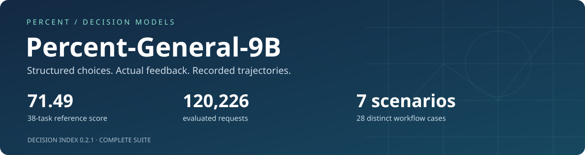
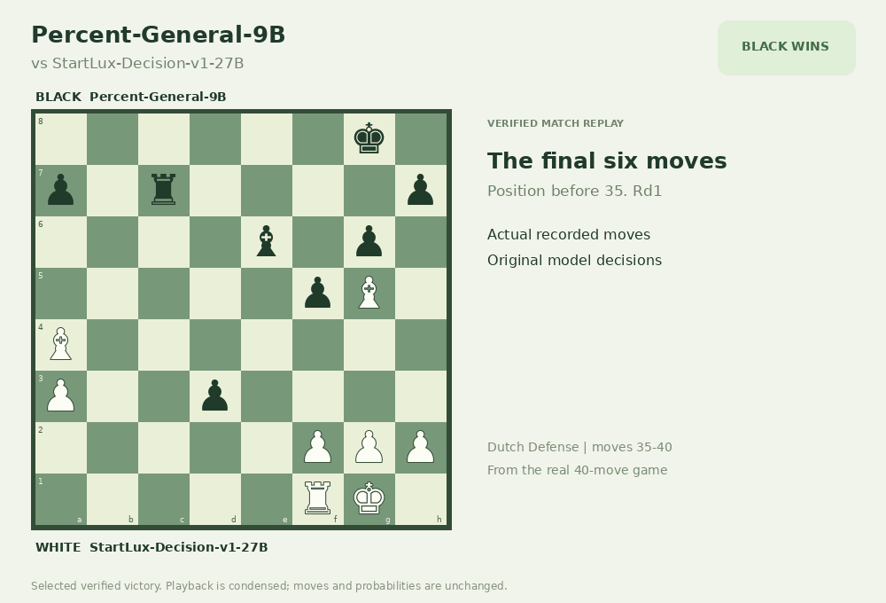
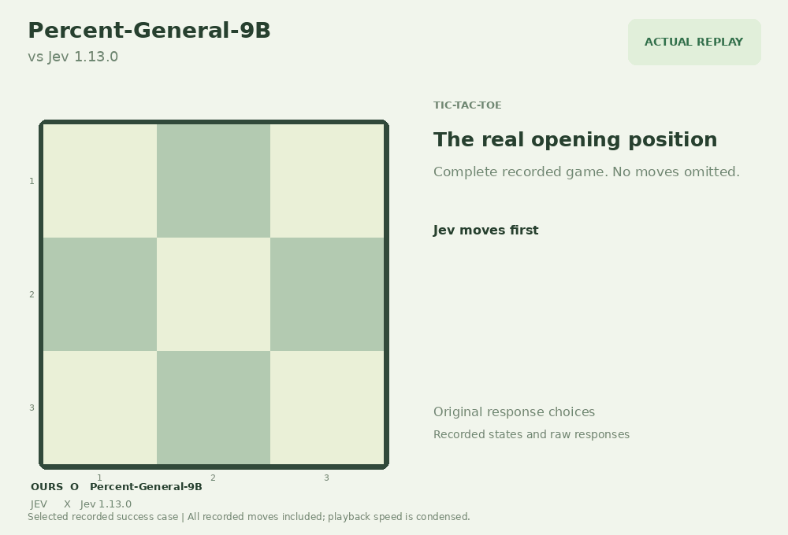
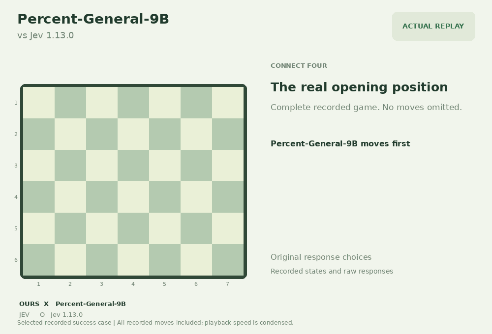
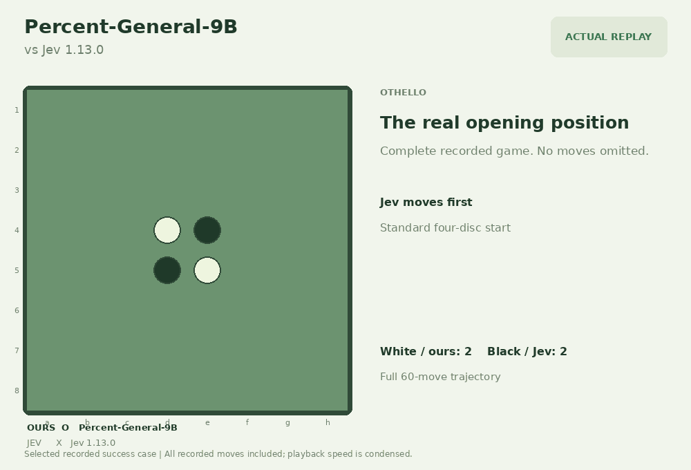
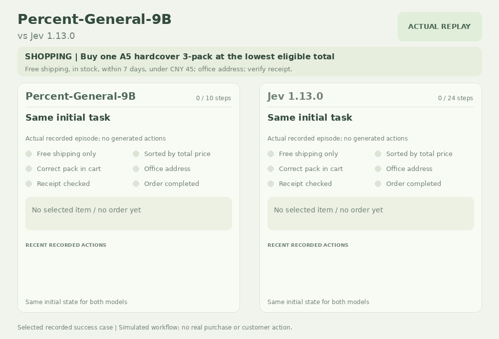
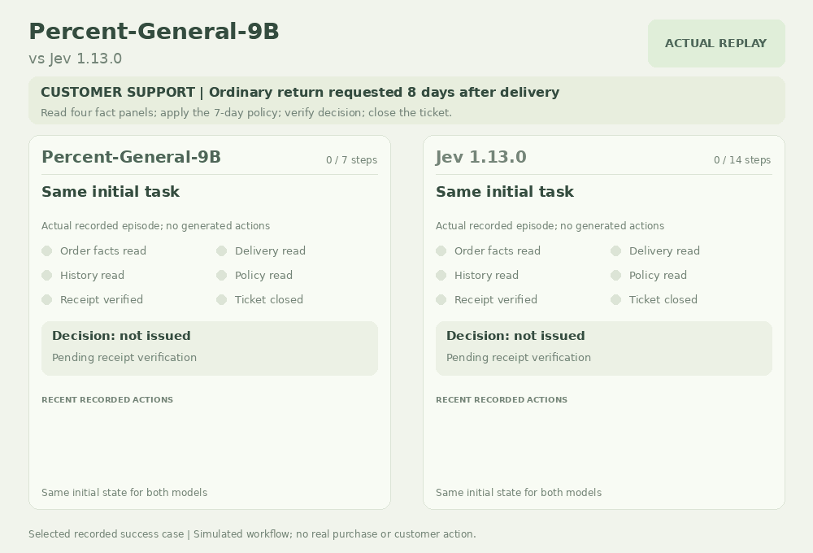

# Percent-General-9B

**从当前状态中选择下一步动作的9B决策模型**

候选动作评分 · 完整概率分布 · 执行反馈

[English](README.en.md) · [简体中文](README.md)

[完整评测对比](#完整全量评测对比) · [成功Demo](#demo精选成功案例) · [评测数据集](#评测数据集)

**Percent-General-9B**接收文本或结构化状态和候选选项，为每个候选项打分，返回概率及选择结果。它适合在显式规则和可执行动作范围内进行分类、工具选择和流程决策。模型使用与决策任务相匹配的合适数据进行训练。

Decision Index **0.2.1完整38项全量评测**，共 **120,226条请求**，本地参考综合分为 **71.49**。

> 当前评测存在基准数据曝光。同行分数引用其公开报告，未在本项目重跑；数值比较不等于独立泛化对照或官方排名。本仓库仅展示评测结果与精选案例。

## Demo：精选成功案例

五个对 **Jev 1.13.0** 的成功记录，以及一局对 **StartLux-Decision-v1-27B** 的国际象棋胜局。以下为探索过程中筛选的实际记录，**不代表总体胜率或整体能力领先**。

[交互回放说明与完整轨迹](DEMOS.zh-CN.md) · [下载全部6个GIF](docs/gifs.zip)

<table>
  <tr>
    <td width="50%"> <b>国际象棋</b>：执黑以40…Rxd1#将杀获胜；对手StartLux-Decision-v1-27B。</td>
    <td width="50%"> <b>井字棋</b>：后手6次落子完成顶行三连。</td>
  </tr>
  <tr>
    <td width="50%"> <b>四子棋</b>：先手第19次落子完成四连。</td>
    <td width="50%"> <b>黑白棋</b>：执白以36:28获胜，取得三个角位。</td>
  </tr>
  <tr>
    <td width="50%"> <b>模拟购物</b>：10步选中最低价合规套装，29.90元送到办公室并核对回执。</td>
    <td width="50%"> <b>客服工单仿真</b>：按仿真环境的七天退货规则处理超期请求，7步完成核验与关闭。</td>
  </tr>
</table>

模型接收结构化状态和候选动作；页面与GIF回放已记录的状态、动作及候选概率，概率不表示获胜概率。购物、客服均为仿真。完整探索战绩及国际象棋原输入协议的已知限制见[案例说明](DEMOS.zh-CN.md)。

## 完整全量评测对比

对比表中，**每行最高分加粗，并列最高均加粗**；Δ Jev不参与最高分比较。

| Model | Complete 38 benchmarks |
| --- | --- |
| Percent-General-9B | **71.49** |
| StartLux-Decision-27B | 63.88 |
| Jev 1.13 | 57.91 |
| Surogate Rune 26B-A4B v3 | 57.44 |
| Decider chat · Gemma-4-31B | 57.33 |
| AutoJev-27B | 56.40 |

相对Jev 1.13公开总分 57.91，本模型本地参考总分高 **13.58分**。按公开表的舍入精度，逐项skill为 **31项更高**、7项更低。相对StartLux-Decision-27B公开总分 63.88，总分高 **7.61分**。

### 五个领域

| Area · skill % | Percent-General-9B | StartLux 27B | Jev 1.13 |
| --- | --- | --- | --- |
| Knowledge & Reasoning | **56.00** | 44.32 | 51.4 |
| Language Understanding | **79.66** | 74.45 | 62.0 |
| Retrieval & Classification | **72.49** | 66.79 | 55.4 |
| Tools & Automation | **85.11** | 82.18 | 75.1 |
| Arts & Human Taste | **63.49** | 47.85 | 37.7 |

Jev领域分数保留公开来源的一位小数精度。

相对27B公开skill，优势包括PhishNChips、SATA-Bench、CLadder和iSarcasmEval；短板包括 GSM8K 54.92 vs 95.3、BRIGHT 27.68 vs 43.5、ACOS 37.47 vs 50.4、ToolRet 53.42 vs 64.3。总分优势未覆盖所有任务。

### 全部38项对比

单位：skill × 100；★为领域内1.2权重。外部skill保留原报告的一位小数精度；**Δ Jev = Percent-General-9B skill − Jev 1.13 skill**，单位为百分点。

#### Knowledge & Reasoning

| 任务 | Percent-General-9B | StartLux 27B | Jev 1.13 | Δ Jev | Rune 26B-A4B | Decider chat 31B | AutoJev 27B |
| --- | --- | --- | --- | --- | --- | --- | --- |
| GPQA Diamond ★ | 62.59 | 34.0 | **71.4** | -8.81 | 29.2 | 32.0 | 32.6 |
| GSM8K | 54.92 | **95.3** | 75.6 | -20.68 | 75.7 | 78.8 | 61.1 |
| ChessBench | **16.88** | 10.7 | 9.8 | +7.08 | 11.5 | 15.4 | 9.8 |
| MuSR | **73.78** | 48.8 | 46.1 | +27.68 | 44.2 | 43.1 | 39.3 |
| SATA-Bench | **54.43** | 9.3 | 25.4 | +29.03 | 34.0 | 28.4 | 28.9 |
| CRUXEval | **72.44** | 61.6 | 57.1 | +15.34 | 59.4 | 67.2 | 60.2 |
| CLadder | **81.96** | 47.3 | 45.3 | +36.66 | 45.5 | 49.2 | 49.0 |
| HLE ★ | 0.00 | 0.0 | **4.7** | -4.70 | 0.0 | 0.0 | 0.0 |
| MMLU-Pro ★ | 63.77 | 66.0 | **80.5** | -16.73 | 63.1 | 65.8 | 60.1 |
| BBH ★ | 82.29 | 71.3 | **89.7** | -7.41 | 72.7 | 65.5 | 68.3 |

#### Language Understanding

| 任务 | Percent-General-9B | StartLux 27B | Jev 1.13 | Δ Jev | Rune 26B-A4B | Decider chat 31B | AutoJev 27B |
| --- | --- | --- | --- | --- | --- | --- | --- |
| ContractNLI | 79.35 | **80.3** | 59.1 | +20.25 | 66.7 | 61.8 | 68.4 |
| ANLI ★ | **75.00** | 67.0 | 62.2 | +12.80 | 60.3 | 59.8 | 56.0 |
| WinoGrande ★ | 86.58 | **87.1** | 83.9 | +2.68 | 71.9 | 67.3 | 70.3 |
| HellaSwag ★ | 96.67 | **96.8** | 92.7 | +3.97 | 89.9 | 89.4 | 92.0 |
| ACOS | 37.47 | **50.4** | 27.3 | +10.17 | 24.4 | 16.2 | 17.8 |
| FinEntity | **95.60** | 89.3 | 80.8 | +14.80 | 83.0 | 86.6 | 89.6 |
| iSarcasmEval | **81.93** | 52.4 | 36.3 | +45.63 | 49.0 | 37.0 | 49.0 |
| VAST | **79.20** | 73.4 | 46.9 | +32.30 | 64.9 | 59.8 | 56.2 |
| NLI4CT | **89.07** | 72.3 | 69.0 | +20.07 | 62.0 | 66.6 | 70.5 |
| RAGTruth | **71.84** | 70.1 | 51.3 | +20.54 | 51.9 | 52.2 | 59.2 |

#### Retrieval & Classification

| 任务 | Percent-General-9B | StartLux 27B | Jev 1.13 | Δ Jev | Rune 26B-A4B | Decider chat 31B | AutoJev 27B |
| --- | --- | --- | --- | --- | --- | --- | --- |
| BANKING77 ★ | 87.14 | **90.9** | 79.5 | +7.64 | 83.5 | 78.8 | 78.8 |
| CLINC150 ★ | 92.51 | **92.9** | 89.2 | +3.31 | 87.3 | 91.1 | 87.7 |
| BRIGHT ★ | 27.68 | **43.5** | 40.6 | -12.92 | 39.3 | 36.2 | 41.9 |
| Amazon ESCI | **53.73** | 47.9 | 43.8 | +9.93 | 43.9 | 41.2 | 43.7 |
| PhishNChips | **99.50** | 40.9 | 25.1 | +74.40 | 61.8 | 75.0 | 19.9 |
| HoVer | 76.40 | **79.2** | 45.7 | +30.70 | 61.3 | 52.8 | 48.4 |

#### Tools & Automation

| 任务 | Percent-General-9B | StartLux 27B | Jev 1.13 | Δ Jev | Rune 26B-A4B | Decider chat 31B | AutoJev 27B |
| --- | --- | --- | --- | --- | --- | --- | --- |
| BFCL ★ | **98.96** | 96.7 | 94.3 | +4.66 | 93.0 | 97.3 | 96.8 |
| ToolRet | 53.42 | **64.3** | 59.9 | -6.48 | 58.9 | 58.0 | 62.4 |
| API-Bank ★ | **89.37** | 83.8 | 88.0 | +1.37 | 83.0 | 84.8 | 83.8 |
| Home appliances | **86.36** | 77.3 | 52.3 | +34.06 | 46.6 | 62.5 | 73.9 |
| When2Call | **93.83** | 85.7 | 74.6 | +19.23 | 68.0 | 69.2 | 75.6 |

#### Arts & Human Taste

| 任务 | Percent-General-9B | StartLux 27B | Jev 1.13 | Δ Jev | Rune 26B-A4B | Decider chat 31B | AutoJev 27B |
| --- | --- | --- | --- | --- | --- | --- | --- |
| BPoMP | **97.41** | 90.6 | 81.8 | +15.61 | 79.9 | 81.2 | 87.8 |
| Humicroedit | **56.32** | 25.8 | 23.7 | +32.62 | 24.4 | 27.6 | 24.8 |
| POP909 | **71.33** | 50.6 | 15.9 | +55.43 | 65.8 | 27.3 | 37.3 |
| cfcolor | 40.84 | **43.6** | 28.8 | +12.04 | 25.1 | 25.2 | 28.8 |
| ForecastBench ★ | **49.52** | 34.3 | 30.6 | +18.92 | 18.9 | 19.2 | 22.1 |
| Habermas | **55.49** | 18.4 | 21.5 | +33.99 | 16.2 | 24.4 | 15.5 |
| New Yorker | **76.32** | 74.2 | 62.6 | +13.72 | 67.6 | 67.3 | 62.8 |

<b>展开全部38项原始指标与请求数</b>

原始指标包括accuracy、F1、nDCG及整case准确率；各行使用对应指标。ForecastBench一行展示相对于Brier=0.25的转换分。

| 任务 | Metric | 请求 | Percent-General-9B | StartLux 27B | Jev 1.13 |
| --- | --- | --- | --- | --- | --- |
| GPQA Diamond | accuracy | 196 | 71.94 | 50.51 | **78.57** |
| GSM8K | accuracy | 2638 | 61.79 | **96.40** | 79.87 |
| ChessBench | accuracy | 5000 | **23.68** | 18.00 | 17.22 |
| MuSR | accuracy | 752 | **83.51** | 67.82 | 66.09 |
| SATA-Bench | case exact accuracy | 1650 | **55.03** | 10.48 | 26.42 |
| CRUXEval | accuracy | 570 | **82.63** | 75.79 | 72.98 |
| CLadder | accuracy | 5000 | **90.98** | 73.66 | 72.64 |
| HLE | accuracy | 501 | 13.57 | 12.38 | **20.36** |
| MMLU-Pro | accuracy | 12032 | 67.79 | 69.77 | **82.70** |
| BBH | accuracy | 5507 | 87.78 | 80.23 | **92.92** |
| ContractNLI | macro-F1 | 123 | 85.72 | **86.36** | 71.69 |
| ANLI | macro-F1 | 3200 | **83.31** | 77.94 | 74.79 |
| WinoGrande | accuracy | 1267 | 93.29 | **93.53** | 91.95 |
| HellaSwag | accuracy | 10042 | 97.50 | **97.56** | 94.52 |
| ACOS | per-review F1 | 1565 | 39.41 | **51.99** | 29.52 |
| FinEntity | macro-F1 | 979 | **97.01** | 92.72 | 86.98 |
| iSarcasmEval | Sarcasm F1 · track A, English | 4600 | **85.95** | 62.99 | 50.51 |
| VAST | macro-F1 | 3006 | **86.13** | 82.27 | 64.63 |
| NLI4CT | macro-F1 | 5500 | **94.38** | 85.78 | 84.06 |
| RAGTruth | F1 on hallucinated class | 2700 | **86.42** | 85.57 | 76.53 |
| BANKING77 | macro-F1 | 3080 | 87.30 | **90.98** | 79.74 |
| CLINC150 | macro-F1 | 5500 | 92.55 | **92.97** | 89.27 |
| BRIGHT | nDCG@10 | 220 | 36.07 | **50.05** | 47.52 |
| Amazon ESCI | macro-F1 | 5000 | **63.11** | 58.48 | 55.21 |
| PhishNChips | accuracy | 2000 | **99.75** | 70.45 | 62.55 |
| HoVer | accuracy | 4000 | 88.20 | **89.62** | 72.85 |
| BFCL | case exact accuracy | 1694 | **99.23** | 97.58 | 95.75 |
| ToolRet | nDCG@10 | 685 | 59.66 | **69.07** | 65.28 |
| API-Bank | accuracy | 508 | **89.57** | 84.06 | 88.19 |
| Home appliances | case exact accuracy | 88 | **86.36** | 77.27 | 52.27 |
| When2Call | accuracy | 3652 | **95.37** | 89.24 | 80.97 |
| BPoMP | accuracy | 5000 | **98.71** | 95.33 | 90.92 |
| Humicroedit | accuracy | 2628 | **78.16** | 62.90 | 61.87 |
| POP909 | accuracy | 2000 | **71.55** | 51.00 | 16.58 |
| cfcolor | accuracy | 5000 | 70.42 | **71.80** | 64.41 |
| ForecastBench | (0.25 - Brier) / 0.25, higher is better | 10139 | **49.52** | 34.32 | 30.56 |
| Habermas | accuracy | 1676 | **69.33** | 43.79 | 45.94 |
| New Yorker | accuracy | 528 | **81.06** | 79.36 | 70.08 |

**HLE包含在全量评测中：** 本模型68/501正确（13.57%），低于该DI口径的16.41%随机基线，因此skill=0。这里使用DI的501题文本多选一子集，不代表整个HLE题集。

## 评测数据集

本次结果采用 **Decision Index 0.2.1**。上游数据源入口：

- [评测数据来源集合](https://github.com/apolinario/decision-index/blob/main/docs/suite.md#edition-021)
- [0.2.1数据清单](https://github.com/apolinario/decision-index/blob/main/hub/0.2.1/manifest.json)

链接提供各基准的数据来源；本仓库不重新分发完整题目。

同行结果与展示结构参考[StartLuxLabs/StartLux-Decision固定版本](https://github.com/StartLuxLabs/StartLux-Decision/tree/0e7a2e81b9c92756e26d8edd843a44d50e362669)。本文展示Decision Index 0.2.1完整评测结果。
