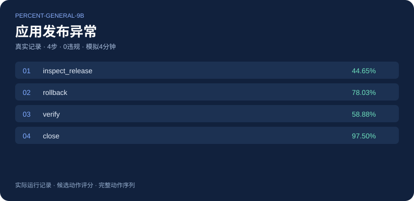
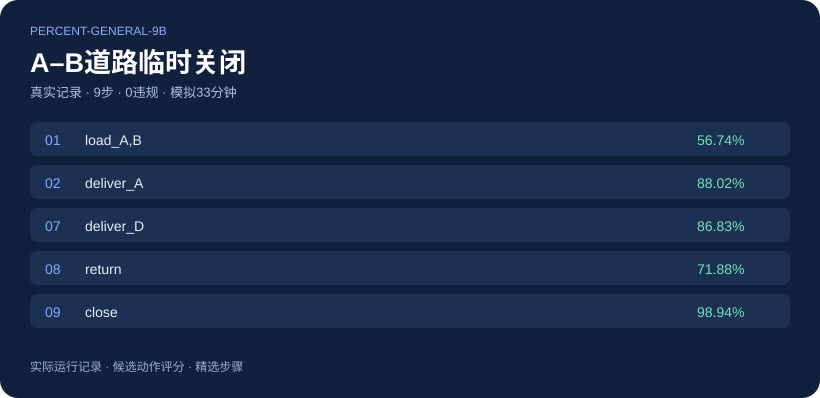
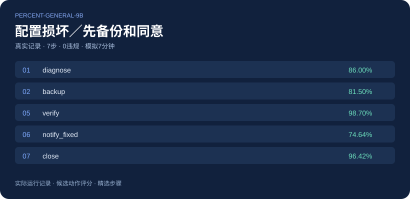
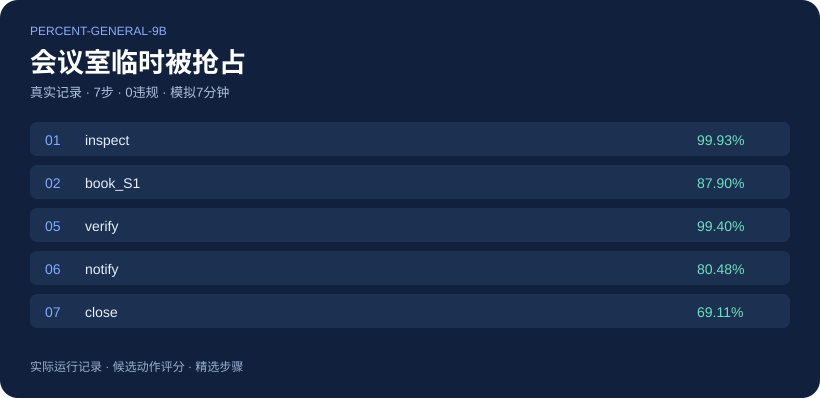
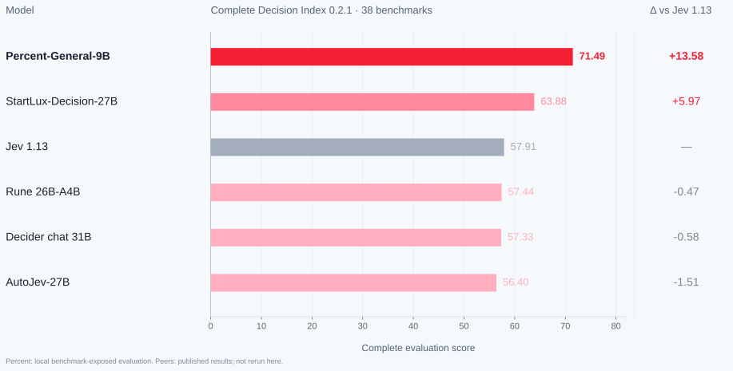
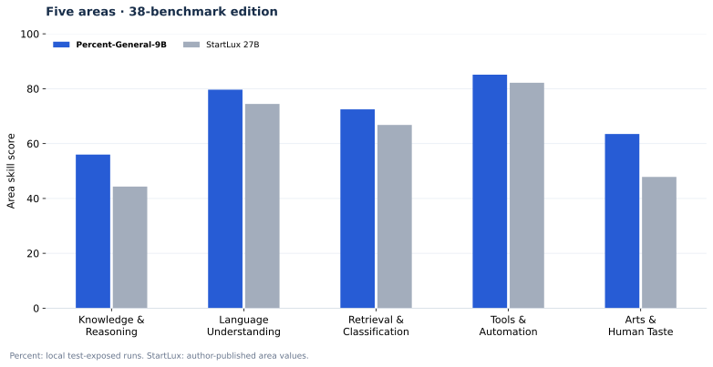

# Percent-General-9B

**从当前状态中选择下一步动作的9B决策模型**

候选动作评分 · 完整概率分布 · 执行反馈

[English](README.en.md) · [简体中文](README.md)

[完整评测对比](#完整全量评测对比) · [成功Demo](#demo精选成功案例) · [评测数据集](#评测数据集)

**Percent-General-9B**接收文本或结构化状态和候选选项，为每个候选项打分，返回概率及选择结果。它适合在显式规则和可执行动作范围内进行分类、工具选择和流程决策。模型使用与决策任务相匹配的合适数据进行训练。

Decision Index **0.2.1完整38项全量评测**，共 **120,226条请求**，本地参考综合分为 **71.49**。

> 当前评测存在基准数据曝光。同行分数引用其公开报告，未在本项目重跑；数值比较不等于独立泛化对照或官方排名。本仓库仅展示评测结果与精选案例。

## Demo：精选成功案例

以下4个案例来自 **Percent-General-9B实际运行记录**，均完成业务目标且 **0违规**。图片展示已记录的动作和候选概率；较长轨迹仅选取部分步骤。

<table>
  <tr>
    <td width="50%"> <b>故障恢复</b>：检查发布 → 回滚 → 端到端验证 → 关闭；<b>4步、模拟4分钟、0违规</b>。</td>
    <td width="50%"> <b>动态配送</b>：途中A–B道路关闭；<b>4单均按时送达</b>，9步、模拟33分钟完成并回仓。</td>
  </tr>
  <tr>
    <td> <b>售后配置恢复</b>：诊断 → 备份 → 明确同意 → 重置 → 验证 → 通知 → 结束；<b>7步、0违规</b>。</td>
    <td> <b>会议冲突处理</b>：首次预订发生并发冲突，刷新日历后预订S2、核验回执并通知；<b>7步、0违规</b>。</td>
  </tr>
</table>

这些是精选成功案例，不代表全部场景的成功率。操作均在模拟环境执行；客服通知使用基于已核验字段的固定模板，所示概率为候选动作评分。

## 完整全量评测对比

对比表中，仅当本模型的分数**严格高于该行所有展示的其他模型**时加粗；持平或较低的分数保持普通字体。

| Model | Complete 38 benchmarks |
| --- | --- |
| Percent-General-9B | **71.49** |
| StartLux-Decision-27B | 63.88 |
| StartLux-Decision-35B-A3B | 61.55 |
| StartLux-Decision-9B | 58.63 |
| StartLux-Decision-4B | 52.75 |
| Jev 1.13 | 57.91 |
| Surogate Rune 26B-A4B v3 | 57.44 |
| Decider chat · Gemma-4-31B | 57.33 |
| AutoJev-27B | 56.40 |

相对StartLux-Decision-27B公开总分 63.88，本模型本地参考总分高 **7.61分**。按公开表的舍入精度，逐项skill为 **25项更高**、12项更低、HLE同为0。

### 五个领域

| Area · skill % | Percent-General-9B | StartLux 9B | StartLux 27B | StartLux 35B-A3B |
| --- | --- | --- | --- | --- |
| Knowledge & Reasoning | **56.00** | 37.97 | 44.32 | 42.39 |
| Language Understanding | **79.66** | 71.28 | 74.45 | 73.58 |
| Retrieval & Classification | **72.49** | 64.12 | 66.79 | 65.79 |
| Tools & Automation | **85.11** | 73.17 | 82.18 | 76.16 |
| Arts & Human Taste | **63.49** | 41.78 | 47.85 | 44.74 |

相对27B公开skill，优势包括PhishNChips、SATA-Bench、CLadder和iSarcasmEval；短板包括 GSM8K 54.92 vs 95.3、BRIGHT 27.68 vs 43.5、ACOS 37.47 vs 50.4、ToolRet 53.42 vs 64.3。总分优势未覆盖所有任务。

### 全部38项对比

单位：skill × 100；★为领域内1.2权重。外部skill保留原报告的一位小数精度；Δ为百分点。

#### Knowledge & Reasoning

| 任务 | Percent-General-9B | StartLux 9B | StartLux 27B | Δ 27B | StartLux 35B-A3B | Jev 1.13 | Rune 26B-A4B | Decider chat 31B | AutoJev 27B |
| --- | --- | --- | --- | --- | --- | --- | --- | --- | --- |
| GPQA Diamond ★ | 62.59 | 33.3 | 34.0 | +28.59 | 34.7 | 71.4 | 29.2 | 32.0 | 32.6 |
| GSM8K | 54.92 | 94.3 | 95.3 | -40.38 | 95.6 | 75.6 | 75.7 | 78.8 | 61.1 |
| ChessBench | **16.88** | 5.3 | 10.7 | +6.18 | 8.8 | 9.8 | 11.5 | 15.4 | 9.8 |
| MuSR | **73.78** | 34.9 | 48.8 | +24.98 | 36.8 | 46.1 | 44.2 | 43.1 | 39.3 |
| SATA-Bench | **54.43** | 25.3 | 9.3 | +45.13 | 27.5 | 25.4 | 34.0 | 28.4 | 28.9 |
| CRUXEval | **72.44** | 36.5 | 61.6 | +10.84 | 54.4 | 57.1 | 59.4 | 67.2 | 60.2 |
| CLadder | **81.96** | 36.1 | 47.3 | +34.66 | 39.1 | 45.3 | 45.5 | 49.2 | 49.0 |
| HLE ★ | 0.00 | 0.0 | 0.0 | +0.00 | 0.0 | 4.7 | 0.0 | 0.0 | 0.0 |
| MMLU-Pro ★ | 63.77 | 56.5 | 66.0 | -2.23 | 63.0 | 80.5 | 63.1 | 65.8 | 60.1 |
| BBH ★ | 82.29 | 58.2 | 71.3 | +10.99 | 65.4 | 89.7 | 72.7 | 65.5 | 68.3 |

#### Language Understanding

| 任务 | Percent-General-9B | StartLux 9B | StartLux 27B | Δ 27B | StartLux 35B-A3B | Jev 1.13 | Rune 26B-A4B | Decider chat 31B | AutoJev 27B |
| --- | --- | --- | --- | --- | --- | --- | --- | --- | --- |
| ContractNLI | 79.35 | 80.6 | 80.3 | -0.95 | 78.9 | 59.1 | 66.7 | 61.8 | 68.4 |
| ANLI ★ | **75.00** | 64.6 | 67.0 | +8.00 | 66.8 | 62.2 | 60.3 | 59.8 | 56.0 |
| WinoGrande ★ | 86.58 | 83.0 | 87.1 | -0.52 | 86.0 | 83.9 | 71.9 | 67.3 | 70.3 |
| HellaSwag ★ | 96.67 | 95.7 | 96.8 | -0.13 | 97.0 | 92.7 | 89.9 | 89.4 | 92.0 |
| ACOS | 37.47 | 46.2 | 50.4 | -12.93 | 50.5 | 27.3 | 24.4 | 16.2 | 17.8 |
| FinEntity | **95.60** | 82.6 | 89.3 | +6.30 | 83.3 | 80.8 | 83.0 | 86.6 | 89.6 |
| iSarcasmEval | **81.93** | 51.9 | 52.4 | +29.53 | 58.7 | 36.3 | 49.0 | 37.0 | 49.0 |
| VAST | **79.20** | 68.7 | 73.4 | +5.80 | 70.3 | 46.9 | 64.9 | 59.8 | 56.2 |
| NLI4CT | **89.07** | 66.1 | 72.3 | +16.77 | 70.0 | 69.0 | 62.0 | 66.6 | 70.5 |
| RAGTruth | **71.84** | 67.5 | 70.1 | +1.74 | 68.7 | 51.3 | 51.9 | 52.2 | 59.2 |

#### Retrieval & Classification

| 任务 | Percent-General-9B | StartLux 9B | StartLux 27B | Δ 27B | StartLux 35B-A3B | Jev 1.13 | Rune 26B-A4B | Decider chat 31B | AutoJev 27B |
| --- | --- | --- | --- | --- | --- | --- | --- | --- | --- |
| BANKING77 ★ | 87.14 | 91.3 | 90.9 | -3.76 | 91.0 | 79.5 | 83.5 | 78.8 | 78.8 |
| CLINC150 ★ | 92.51 | 93.1 | 92.9 | -0.39 | 93.7 | 89.2 | 87.3 | 91.1 | 87.7 |
| BRIGHT ★ | 27.68 | 41.3 | 43.5 | -15.82 | 41.7 | 40.6 | 39.3 | 36.2 | 41.9 |
| Amazon ESCI | **53.73** | 47.4 | 47.9 | +5.83 | 46.3 | 43.8 | 43.9 | 41.2 | 43.7 |
| PhishNChips | **99.50** | 28.5 | 40.9 | +58.60 | 38.2 | 25.1 | 61.8 | 75.0 | 19.9 |
| HoVer | 76.40 | 76.5 | 79.2 | -2.80 | 78.1 | 45.7 | 61.3 | 52.8 | 48.4 |

#### Tools & Automation

| 任务 | Percent-General-9B | StartLux 9B | StartLux 27B | Δ 27B | StartLux 35B-A3B | Jev 1.13 | Rune 26B-A4B | Decider chat 31B | AutoJev 27B |
| --- | --- | --- | --- | --- | --- | --- | --- | --- | --- |
| BFCL ★ | **98.96** | 97.0 | 96.7 | +2.26 | 96.7 | 94.3 | 93.0 | 97.3 | 96.8 |
| ToolRet | 53.42 | 61.5 | 64.3 | -10.88 | 64.0 | 59.9 | 58.9 | 58.0 | 62.4 |
| API-Bank ★ | **89.37** | 77.9 | 83.8 | +5.57 | 79.5 | 88.0 | 83.0 | 84.8 | 83.8 |
| Home appliances | **86.36** | 38.6 | 77.3 | +9.06 | 51.1 | 52.3 | 46.6 | 62.5 | 73.9 |
| When2Call | **93.83** | 85.2 | 85.7 | +8.13 | 84.7 | 74.6 | 68.0 | 69.2 | 75.6 |

#### Arts & Human Taste

| 任务 | Percent-General-9B | StartLux 9B | StartLux 27B | Δ 27B | StartLux 35B-A3B | Jev 1.13 | Rune 26B-A4B | Decider chat 31B | AutoJev 27B |
| --- | --- | --- | --- | --- | --- | --- | --- | --- | --- |
| BPoMP | **97.41** | 82.1 | 90.6 | +6.81 | 85.7 | 81.8 | 79.9 | 81.2 | 87.8 |
| Humicroedit | **56.32** | 24.3 | 25.8 | +30.52 | 24.7 | 23.7 | 24.4 | 27.6 | 24.8 |
| POP909 | **71.33** | 25.5 | 50.6 | +20.73 | 32.0 | 15.9 | 65.8 | 27.3 | 37.3 |
| cfcolor | 40.84 | 42.4 | 43.6 | -2.76 | 42.5 | 28.8 | 25.1 | 25.2 | 28.8 |
| ForecastBench ★ | **49.52** | 26.6 | 34.3 | +15.22 | 30.6 | 30.6 | 18.9 | 19.2 | 22.1 |
| Habermas | **55.49** | 22.5 | 18.4 | +37.09 | 26.2 | 21.5 | 16.2 | 24.4 | 15.5 |
| New Yorker | **76.32** | 72.1 | 74.2 | +2.12 | 74.2 | 62.6 | 67.6 | 67.3 | 62.8 |

<b>展开全部38项原始指标与请求数</b>

原始指标包括accuracy、F1、nDCG及整case准确率；各行使用对应指标。ForecastBench一行展示相对于Brier=0.25的转换分。

| 任务 | Metric | 请求 | Percent-General-9B | StartLux 9B | StartLux 27B | StartLux 35B-A3B | Jev 1.13 |
| --- | --- | --- | --- | --- | --- | --- | --- |
| GPQA Diamond | accuracy | 196 | 71.94 | 50.00 | 50.51 | 51.02 | 78.57 |
| GSM8K | accuracy | 2638 | 61.79 | 95.68 | 96.40 | 96.63 | 79.87 |
| ChessBench | accuracy | 5000 | **23.68** | 13.04 | 18.00 | 16.26 | 17.22 |
| MuSR | accuracy | 752 | **83.51** | 59.04 | 67.82 | 60.24 | 66.09 |
| SATA-Bench | case exact accuracy | 1650 | **55.03** | 26.30 | 10.48 | 28.48 | 26.42 |
| CRUXEval | accuracy | 570 | **82.63** | 60.00 | 75.79 | 71.23 | 72.98 |
| CLadder | accuracy | 5000 | **90.98** | 68.06 | 73.66 | 69.56 | 72.64 |
| HLE | accuracy | 501 | 13.57 | 10.18 | 12.38 | 10.18 | 20.36 |
| MMLU-Pro | accuracy | 12032 | 67.79 | 61.29 | 69.77 | 67.10 | 82.70 |
| BBH | accuracy | 5507 | 87.78 | 71.18 | 80.23 | 76.10 | 92.92 |
| ContractNLI | macro-F1 | 123 | 85.72 | 86.58 | 86.36 | 85.44 | 71.69 |
| ANLI | macro-F1 | 3200 | **83.31** | 76.39 | 77.94 | 77.85 | 74.79 |
| WinoGrande | accuracy | 1267 | 93.29 | 91.48 | 93.53 | 92.98 | 91.95 |
| HellaSwag | accuracy | 10042 | 97.50 | 96.76 | 97.56 | 97.74 | 94.52 |
| ACOS | per-review F1 | 1565 | 39.41 | 47.82 | 51.99 | 52.00 | 29.52 |
| FinEntity | macro-F1 | 979 | **97.01** | 88.20 | 92.72 | 88.63 | 86.98 |
| iSarcasmEval | Sarcasm F1 · track A, English | 4600 | **85.95** | 62.59 | 62.99 | 67.87 | 50.51 |
| VAST | macro-F1 | 3006 | **86.13** | 79.13 | 82.27 | 80.18 | 64.63 |
| NLI4CT | macro-F1 | 5500 | **94.38** | 82.60 | 85.78 | 84.56 | 84.06 |
| RAGTruth | F1 on hallucinated class | 2700 | **86.42** | 84.32 | 85.57 | 84.89 | 76.53 |
| BANKING77 | macro-F1 | 3080 | 87.30 | 91.40 | 90.98 | 91.14 | 79.74 |
| CLINC150 | macro-F1 | 5500 | 92.55 | 93.15 | 92.97 | 93.70 | 89.27 |
| BRIGHT | nDCG@10 | 220 | 36.07 | 48.08 | 50.05 | 48.44 | 47.52 |
| Amazon ESCI | macro-F1 | 5000 | **63.11** | 58.07 | 58.48 | 57.18 | 55.21 |
| PhishNChips | accuracy | 2000 | **99.75** | 64.25 | 70.45 | 69.10 | 62.55 |
| HoVer | accuracy | 4000 | 88.20 | 88.25 | 89.62 | 89.05 | 72.85 |
| BFCL | case exact accuracy | 1694 | **99.23** | 97.76 | 97.58 | 97.52 | 95.75 |
| ToolRet | nDCG@10 | 685 | 59.66 | 66.63 | 69.07 | 68.82 | 65.28 |
| API-Bank | accuracy | 508 | **89.57** | 78.35 | 84.06 | 79.92 | 88.19 |
| Home appliances | case exact accuracy | 88 | **86.36** | 38.64 | 77.27 | 51.14 | 52.27 |
| When2Call | accuracy | 3652 | **95.37** | 88.86 | 89.24 | 88.53 | 80.97 |
| BPoMP | accuracy | 5000 | **98.71** | 91.04 | 95.33 | 92.84 | 90.92 |
| Humicroedit | accuracy | 2628 | **78.16** | 62.18 | 62.90 | 62.37 | 61.87 |
| POP909 | accuracy | 2000 | **71.55** | 26.12 | 51.00 | 32.51 | 16.58 |
| cfcolor | accuracy | 5000 | 70.42 | 71.18 | 71.80 | 71.27 | 64.41 |
| ForecastBench | (0.25 - Brier) / 0.25, higher is better | 10139 | **49.52** | 26.60 | 34.32 | 30.64 | 30.56 |
| Habermas | accuracy | 1676 | **69.33** | 46.60 | 43.79 | 49.16 | 45.94 |
| New Yorker | accuracy | 528 | **81.06** | 77.65 | 79.36 | 79.36 | 70.08 |

**HLE包含在全量评测中：** 本模型68/501正确（13.57%），低于该DI口径的16.41%随机基线，因此skill=0。这里使用DI的501题文本多选一子集，不代表整个HLE题集。

## 评测数据集

本次结果采用 **Decision Index 0.2.1**。上游数据源入口：

- [评测数据来源集合](https://github.com/apolinario/decision-index/blob/main/docs/suite.md#edition-021)
- [0.2.1数据清单](https://github.com/apolinario/decision-index/blob/main/hub/0.2.1/manifest.json)

链接提供各基准的数据来源；本仓库不重新分发完整题目。

同行结果与展示结构参考[StartLuxLabs/StartLux-Decision固定版本](https://github.com/StartLuxLabs/StartLux-Decision/tree/0e7a2e81b9c92756e26d8edd843a44d50e362669)。其他榜单系统的数值为该来源记录的2026-09-28快照。本文展示Decision Index 0.2.1完整评测结果。
